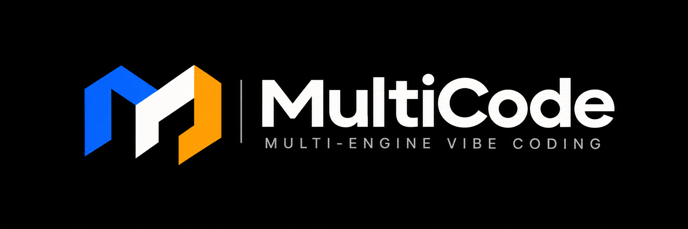

<p align="center"></p>

# MultiCode

**One workspace. Many engines.**

Connect the AI accounts you already have — **subscriptions or API keys** — and let them
build your project together as a crew.

* A **Dispatcher** plans the work and assigns every task to the best-fitting agent, weighing
  each member's specialty and cost (free → subscription → pay-per-token). One click makes a
  **free OpenCode model** your dispatcher, so paid models spend their time building.
* **Builders** write the code **in parallel**. Each member can run up to 4 agents of its own and
  carry its own specialty or instructions.
* Every task is **verified**: an agent that writes nothing, goes silent (4 min) or runs too long
  (15 min) is stopped and its task is **reassigned** to another agent.
* A **Reviewer** checks the result and sends fixes back to the agent that wrote the file.
* **Undo** any thread (like rewind in Claude Code or undo in Codex); edits made after it are
  detected and never silently overwritten.
* **Sync across harnesses:** shared instructions, MCP servers and project memory reach Claude Code,
  Codex, Gemini CLI, Qwen Code and OpenCode through the files each one reads.
* **Plugins**, wired into every harness automatically (pinned versions):
  * **Memory graph** (on): a shared knowledge graph; MultiCode records every thread in it.
  * **AI browser** (on): Playwright MCP, limited to the app preview unless you allow any website.
  * Chrome DevTools, live library docs (Context7), sequential thinking.
  * **Computer control** and **Desktop Commander**: off; turning them on needs an explicit confirmation.
* **Skill packs** (Agent Skills / `SKILL.md`): quality, web craft, testing, Node & TypeScript, Python,
  Roblox & Luau. In Auto they switch on from your request and the project's files, land in
  `.claude/skills`, `.agents/skills`, `.gemini/skills`, `.qwen/skills`, and are inlined for API agents.

## Connect your AI

| You have | Choose | What MultiCode uses |
|---|---|---|
| Claude Pro / Max | Claude subscription | `claude` (Claude Code CLI) |
| ChatGPT Plus / Pro | ChatGPT subscription | `codex` (Codex CLI) |
| Google AI Pro / free Google account | Google subscription | `gemini` (Gemini CLI) |
| Anthropic / OpenAI / Gemini API key | the matching API | official SDKs |
| OpenRouter, Groq, DeepSeek, Ollama, LM Studio… | OpenAI-compatible API | any `/v1` endpoint |
| Nothing yet — start free | OpenCode | `opencode` with its free models (e.g. `opencode/big-pickle`) |
| GitHub Copilot, or any of 75+ providers | OpenCode | `opencode auth login`, then pick `provider/model` |
| A free Qwen account | Qwen Code | `qwen` |
| Any other coding agent: Copilot, Cursor, Goose, Kiro, Qoder, Cline, Junie, Amp, Devin… | Any ACP agent | the [Agent Client Protocol](https://agentclientprotocol.com) registry |

Subscriptions don't come with API keys, so MultiCode drives each vendor's official CLI
on your machine. Install the CLI and sign in once:

```bash
npm i -g @anthropic-ai/claude-code   # then run: claude
npm i -g @openai/codex               # then run: codex login
npm i -g @google/gemini-cli          # then run: gemini

# Open-source agents
npm i -g opencode-ai                 # free models work immediately
npm i -g @qwen-code/qwen-code        # then run: qwen
```

In the crew editor, the model field suggests every model the agent offers (OpenCode lists 200+).

### Any ACP agent

Like T3 Code, MultiCode speaks the open **Agent Client Protocol**. *Connections → Any ACP agent*
lists every agent in the public ACP registry (45+). Agents shipped through npm or uv run with
`npx`/`uvx`; agents shipped as downloads are installed on **Install** into MultiCode's data folder,
after checking the registry's SHA-256. You can also connect any ACP command of your own.

MultiCode is the ACP client, so it decides what an agent may do: file reads and writes go through
MultiCode and stay inside the project (writes only in edit tasks), reading and searching are
allowed, file edits are allowed in edit tasks, and shell commands, web fetches and unknown tools
are refused. Each agent uses its own sign-in; run it once in a terminal if it asks you to log in.

## Run it

Requires Node.js 20+.

```bash
npm install
npm run build
npm start            # → http://localhost:4317   (add -- --open to open the browser)
```

For development (`tsx watch` + Vite with hot reload): `npm run dev`, then open http://localhost:5173.

Your projects live in `~/.multicode/projects/<name>` and thread history in `~/.multicode/runs`
(override the folder with `MULTICODE_HOME`). Threads, their agent output and their diffs survive restarts.

On first launch a short tutorial walks you through it: connect an AI, meet your crew, name your
first project (MultiCode doesn't create one for you), and ask for something, from scratch or from
an example. Each step ticks itself off from what you actually did. Skip it any time; bring it back
from **Settings → Tutorial** or `Ctrl K` → *Show the tutorial*.

### Make it yours

**Settings** (bottom of the sidebar) holds Connections, Crew, Savings & safety, Plugins & skills,
Sync and Appearance. **Appearance** (or `Ctrl K` → Appearance): theme (system, light, dark),
accent colour (6 presets or any colour), font, interface size, animations, background ribbons (off by default) and
the opening animation. Saved in your browser and applied before the first paint.

### Shortcuts

| Keys | Action |
|---|---|
| `Ctrl K` / `⌘K` | Command palette: jump to any thread or project, open crew, connections, preview, files, changes |
| `Enter` / `Shift Enter` | Send to the crew / new line |

## Save credits, never stall

* **Free fallback:** when a subscription or API key hits its usage limit (429, quota, "usage limit
  reached"…), a free OpenCode model takes over that agent's work immediately. The account is skipped
  until its limit resets (parsed from the error, else 1 h; 2 min for short rate limits).
* **Economy mode:** free and flat-rate members get the work first, the cheapest member reviews
  (one round), and agents receive smaller context.
* **Token meter:** every thread shows tokens used, how many came from free models, and cost where
  the provider reports it.
* **Auto crew from one key:** connect one multi-model key (e.g. OpenRouter) and press *Auto crew*:
  free models dispatch and review, OpenRouter's Auto Router builds with 3 parallel agents.

## Safety modes

* **Direct, with undo** (default): agents edit the project; every thread can be undone.
* **Sandbox:** agents work on a copy without your secrets; you review and *Apply* or *Discard*.
* **Plan only:** agents read and plan, nothing changes.
* **Protected files** (`.env`, keys, `secrets/**`, your own patterns) are never sent to models,
  are left out of sandboxes, and any change to them is rolled back immediately.

## MultiDesign

Switch the composer to **MultiDesign**: up to four models each design their own take (calm minimal,
bold expressive, warm editorial, dark technical) in separate sandboxes, at the same time. Compare
the live previews side by side and click *Use this design*.

## Sync across harnesses

| Harness | Instructions + memory | MCP servers |
|---|---|---|
| Claude Code | `CLAUDE.md` | `.mcp.json` |
| Codex | `AGENTS.md` | passed per run (`-c mcp_servers.*`) |
| Gemini CLI | `GEMINI.md` | `.gemini/settings.json` |
| Qwen Code | `QWEN.md` | `.qwen/settings.json` |
| OpenCode | `AGENTS.md` | `opencode.json` |

MultiCode edits only its own marked block and the MCP entries it created; your own content is
kept. Secrets are stored in MultiCode's private config and injected into agent processes; project
files only reference variable names.

## Security

* The server only listens on `127.0.0.1` and rejects non-loopback `Host` headers.
* State-changing API calls require an `X-MultiCode` header (blocks cross-site requests).
* API keys are stored in `~/.multicode/config.json` with `0600` permissions and are never sent back to the browser.
* Model-written file paths are confined to the project folder (`..`, absolute paths, `.git` and `node_modules` are refused).
* The preview runs in a sandboxed, opaque origin, so generated code cannot call MultiCode's API.
* CLI agents run with edit-only permissions (`acceptEdits` / `workspace-write` / `auto_edit` / `auto-edit`), and read-only for planning and review. OpenCode runs with its shell and web tools removed. MultiCode never passes "bypass all permissions" flags.

## Tests

```bash
npm test         # parsers, path safety, scheduler, full crew run, HTTP guards, SSE
npm run typecheck
```

See [docs/DESIGN.md](docs/DESIGN.md) for the architecture.

## Brand

| | |
|---|---|
| Graphite | `#0B0C0F` |
| Off-White | `#F5F4EF` |
| Cobalt (primary) | `#2563FF` |
| Amber (highlight) | `#F59E0B` |
| Type | Inter (Semibold / Medium / Regular) |

Logo, app icon and the brand sheet live in [`assets/brand/`](assets/brand/).

## Trademarks

Provider logos come from [@lobehub/icons](https://github.com/lobehub/lobe-icons) (MIT). Claude,
Claude Code, OpenAI, Codex, Gemini, Qwen, OpenCode and the other names and logos are trademarks of
their owners. MultiCode uses them only to show which service a connection uses and is not
affiliated with or endorsed by any of them.
